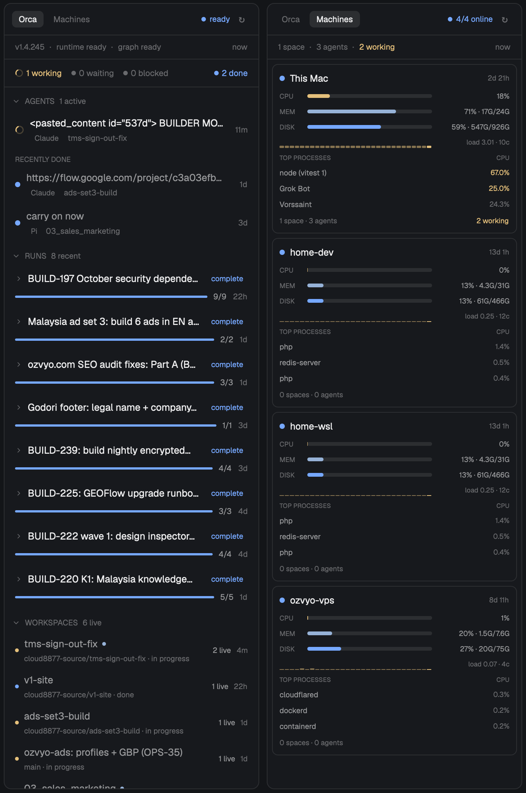

# Orca status

A 340 px panel for the right side of a Herdr window with two views you switch between. **Orca** shows what the Orca CLI reports is running: its agents, its orchestration runs and their tasks, and its workspaces. **Machines** is a small btop for every machine this Herdr is connected to: one card per machine with CPU, memory and disk bars, a 30-sample CPU history, load average, uptime and the three busiest processes, plus that machine's Herdr spaces and agents.

## What you see

One panel on a `background` fill, 1 px `border`, 10 px radius, 13 px text, 340 px wide (320–520).

**Header**, 42 px tall, 10 px side padding, 4 px gaps: two view pills on the left, then a health readout and a refresh button on the right.

- Pills "Orca" and "Machines": 22 px tall, 9 px side padding, 6 px radius, 11 px text. The active one is `raised` with `foreground` text at medium weight; the other is `dim` and turns `hover` + `foreground` under the pointer.
- Health: a 6 px dot and a 10.5 px word. Orca view: `ready` (done colour) when Orca's app is running and its runtime says ready, `starting`/`offline`/`status unknown` otherwise, `unreachable` (`blocked`) when the CLI failed. Machines view: `4/4 online`, `done` when every machine answered, `working` when some did, `blocked` when none did.
- Refresh: a 24×24 button with a 14 px `↻` in `dim`; while a sample is in flight it is the 12 px spinner in `working`. Hover: `hover` background, `foreground`.

**Machines view.** A 7 px-padded strip under the header in 10.5 px `dim`: `1 space · 3 agents · 2 working · 1 needs you` for everything Herdr knows, with the sample's age (`now`, `2m`) at the right. Then a scrolling column of cards, 6 px side margins, 6 px apart.

Each card is `surface`, 1 px `border`, 8 px radius, 9 px × 8 px padding, 6 px row gaps:

- Header: a 7 px dot, the machine's name at 12.5 px medium, and its uptime at 9.5 px `dim` on the right (`2d 21h`, `13d 1h`). This machine is called `This Mac` (from `window().platform`; `This PC` on Windows, `This machine` elsewhere); remote cards use the machine name from `hc machine ls`.
- Three metric rows, each a 9 px medium `dim` label in 30 px (`CPU`, `MEM`, `DISK`), a 5 px track (`raised`, 3 px radius, a `working`/`accent`/`done` fill from the left) and a 96 px right-aligned value at 9.5 px `muted`:
  - `CPU  18%`
  - `MEM  70% · 17G/24G`
  - `DISK 59% · 547G/926G` (used = total × percent)
- The CPU history: 30 slots, 1 px gaps, 1 px minimum height up to 15 px, newest on the right, empty slots as 1 px `raised` stubs. Every bar is `working` with a 53 % alpha (hex `88` suffix) except the newest, which is solid; a slot at 90 % or more is `blocked`. To its right `load 4.04 · 10c` in 9 px `dim` in the same 96 px column.
- `TOP PROCESSES` / `CPU` headers at 8.5 px medium `dim`, then three rows: process name at 10 px `muted` (basename, cut at 26 characters with `…`) and its CPU share right-aligned in 36 px at 9.5 px `dim`, `working` at 25 % or more.
- Footer at 9.5 px: `1 space · 3 agents` in `dim` on the left, then `2 working` in `working` and `1 needs you` in `blocked` medium — this machine's Herdr agents, not Orca's.

A card whose machine is unreachable squeezes to its header plus one 10 px line: `Herdr can't reach this machine's core.` in `dim` when Herdr already knows the core is down, or the `exec` error in `blocked` with the border tinted `blocked` at 33 % alpha. While the first sample is in flight the line says `Reading CPU, memory and disk…` and the dot is the spinner.

**Orca view.** Under the header, two strips and a scrolling column of three folding sections:

- Info strip (7 px padding, 10.5 px `dim`): `v1.4.245 · runtime ready · graph ready`, the graph word in `blocked` when it isn't ready, and the load age at the right. Before the first answer the body is a 20 px spinner and `Reading Orca…`; when the CLI fails it is the error and a `Retry` button instead.
- Counter strip (14 px sides, 9 px vertical, 12 px gaps, wraps): `1 working`, `0 waiting`, `0 blocked` on the left, `11 done` pushed right; each is a 6 px dot (a spinner for `working`) and an 11 px count, greyed when zero.
- **AGENTS** section header: an 11 px chevron, the title at 10.5 px medium `dim`, and `1 active` (or `11 done` when none are active) at the right. Rows: 6 px side margins, 8 px/6 px padding, 8 px radius; a state dot, the agent's task (or prompt, or "Agent") truncated at 13 px, and under it a 10 px type chip (`Claude`, `Pi`, `Codex`, …), the worktree at 10.5 px `dim`, and `needs you` in `blocked` when blocked; the age (`4m`) sits at the right at 10.5 px `dim`. Blocked rows get a `blocked` 7 % background. A click expands PROMPT, LAST MESSAGE (cut at 900 characters), TOOL and PATH under a 23 px indent, in 9 px `dim` labels and 11.5 px text. Below the active rows, `RECENTLY DONE` with a `Show all 11` link past four rows; done rows have a `done` dot and `muted` titles.
- **RUNS** section: header right says `2 active` or `8 recent`. A run row shows the objective at 13 px truncated, a chip with its state (`running` in `working`, `complete` in `done`, `3 issues` in `blocked`, `no tasks` in `dim`), and under it a 3 px progress track with `9/9` and the age; `1 decision waiting` in `accent` when a gate is pending, and the error in `blocked`. A click expands the objective in 11 px `muted` and the run's tasks: a 5 px status dot, the task name truncated at 11 px, and its status at 9.5 px.
- **WORKSPACES** section: header right says `12 live`. Each row is a 5 px status dot, the workspace name (`foreground` when active, `muted` otherwise, with a 5 px `accent` dot when unread), `branch · in progress` at 10 px `dim`, then `2 live`/`idle` and the age at 10 px. `Show all 12` past six rows.

## How it behaves

- Orca agent states: `working` is a ring spinner turning once per 900 ms, `waiting` a hollow ring in `accent`, `blocked` a small `blocked` tile with a `!` at 15 % alpha, `done` a solid `done` dot. Progress bars and counters use the same four colours.
- Machine states: `live` a `done` dot, `error` a `blocked` dot, `offline` a `dim` dot, sampling a spinner. `offline` means `machines()` already reports that core `unavailable`; the mod does not wait for a timeout on it.
- Clicking a pill switches view and writes `shared("orca-status.view")`, so the choice survives a reload and the next start. The refresh button re-samples the shown view. Section headers fold and unfold; agent and run rows expand; `Show all …` links toggle. Hovering a pill or row tints it `hover`.
- `cmd-shift-m` (`orca-status.toggle` in `keys.json`) flips the view from anywhere in the app, not only while the panel has focus.
- Data: the Orca view re-reads the CLI every 15 s, the Machines view samples every 5 s — each only while that view is on screen, and switching fetches at once when what it has is older than its interval, so the first look at Machines fills immediately. Live Herdr data (`spaces()`, `agents()`, `machines()`) redraws with no polling. The CPU history is 30 samples, about 2.5 minutes, and starts empty after a mod reload.
- Nothing on a machine card is clickable; the panel is read-only.

## Built from

One mod, no layout file. `mods/orca-status/`:

- `main.js` — one `View`. `init` reads the view from `shared("orca-status.view")`, starts the poll timer for that view and one `nextCommand()` loop, whose `"toggle"` (the part after the dot in `orca-status.toggle`) flips the view; `render` draws the header and then either `machinesView()` or `orcaView()`.
- `mod.json` — `{ "place": "right", "size": 340 }` so a fresh install docks it on the right. In a layout that already names the block, `place` is ignored: the block is `{ "id": "orca", "type": "block", "content": { "mod": "orca-status" }, "size": { "px": 340 }, "min": 320, "max": 520 }`.
- `spinner.svg`, `chevron-down.svg`, `chevron-right.svg` — copied from the shipped `workspace-chrome` mod so this one owns its art. The spinner is a 24 px `currentColor` arc over a 24 % ring at stroke 3.2; the chevrons are Lucide, stroke 2. Referenced app-relative as `mods/orca-status/spinner.svg` and `mods/orca-status/chevron-down.svg`, and tinted with `.text_color()`.
- `keys.json` here is the one section to merge: `{ "global": { "cmd-shift-m": "orca-status.toggle" } }`.

From `herdr`: `exec`, `theme`, `machines`, `spaces`, `agents`, `window`, `shared`, `setShared`, `nextCommand`. Layout is `v_flex`/`h_flex`/`div` from `gpui-kit` and `gpui-base`; bars are a track `div` with a child at `w("<n>%")`, the history is 30 `flex_1` divs with pixel heights.

Live data:

- `machines()` — one entry per machine, `{ name: null }` for this computer, `layout` `ready` / `loading` / `unavailable`. Sorted local first, then by name.
- `spaces()` — each space's `machine`; counted per machine with `agents()` joined by `a.space` for the summary and card footer.
- `window().platform` — only to name the local card.

Orca view, each through `exec("orca", [...])`, answers parsed from JSON (`{ ok, result }`):

- `status --json` (a failure here is not fatal: the header word becomes `status unknown` and the rest still renders)
- `worktree ps --limit 100 --agent-wait --json` — agents and workspaces
- `orchestration run-list --limit 8 --json`
- per run `orchestration task-list --run <id> --brief --json`, and `orchestration gate-list --run <id> --json` only while that run has an unfinished task

Machines view: one `exec("sh", ["-c", SCRIPT], { on: machineName })` per machine, in parallel, `on: null` for this computer. The script is POSIX `sh` that works on Linux and macOS and prints `key=value` lines plus `proc<TAB><cpu><TAB><mem><TAB><name>` lines; the mod splits them and converts to numbers.

- `getconf _NPROCESSORS_ONLN`; load from field 1 of `/proc/loadavg`, or `sysctl -n vm.loadavg` on macOS.
- CPU: two `/proc/stat` reads 0.4 s apart, `1 − (idle + iowait)/total` over the window; on macOS `iostat -w 1 -c 2` and the second data line, `us + sy` (fields 4 and 5).
- Memory: `/proc/meminfo` `MemTotal` and `MemAvailable`; on macOS `vm_stat` (free + inactive + speculative pages × page size) against `hw.memsize`.
- Disk: `df -Pk "$HOME"` — the home filesystem, because macOS's `/` is read-only and nearly empty. Percent from column 5, size from the 1K blocks.
- Uptime: `date +%s` minus the first field of `/proc/uptime`, or the `sec =` field of `kern.boottime`.
- Processes: `ps -eo pcpu=,pmem=,comm= --sort=-pcpu | head -4`; on macOS `ps -Ao pcpu=,pmem=,comm= -r | head -4`.

## Watch out

- `exec` on another machine goes through that machine's herdr-core: a core that is down can't run the script at all, which is why `machines()` `unavailable` is handled as `offline` instead of being sampled.
- The script needs `sh`, so machines must be POSIX (this setup is one Mac plus three Linux boxes; two of them are different machine names pointing at the same host, which is why two cards can show identical numbers). A Windows machine gets an error card, not a card with empty bars.
- `exec` writes the script through `sh -c`, so it must stay a shell string with no `${…}` inside a JS template literal — use `$var`, not `${var}`, or the JavaScript interpolates it.
- macOS `awk` is BWK awk: a ternary directly inside `printf` needs parentheses (`printf "%d", (t > 0 ? a : b)`), otherwise `>` is read as a redirection and the script dies with "syntax error".
- macOS has no `/proc`, and its `ps` `%cpu` is a lifetime average, so the CPU number must come from `iostat`; memory percentages must come from `vm_stat` pages, not from `free`.
- `ps` `%cpu` is per core: one busy core on a 4-core box reads `100%`. Bars cap at 100 %, the text prints the raw number, and the load average next to it is the honest capacity signal.
- Sampling happens only while the Machines view is shown, so the history does not backfill the time spent on the Orca view — after a switch the strip starts short and fills from the right. That is deliberate: it keeps an idle panel from running four shells every 5 s.
- The view lives in shared state, so two copies of the mod (two layouts) follow the same switch.
- `gig()` prints whole gigabytes at 10 GB and above and one decimal below (`7.6G`); `ago()` says `now` under 45 s, then minutes, hours, days.
- Limits: 30 history slots, 3 processes, 26-character process names, 96 px value column. Below ~300 px of block width the value column starts to crowd the bar.
- Nothing yet: no per-core CPU, no network throughput, no temperature, no swap (the script doesn't emit it), no clicking a machine to open a space on it, no filter or sort controls.
- The Orca view needs the `orca` CLI on the same machine as the app; without it the panel shows an `unreachable` banner with a Retry button and the Machines view still works.
- `herdr-app check` renders only the first frame, before any `exec` resolves: it proves the shell and the empty states, not the cards or the agent rows. Look at the real window (`herdr-app shot`) with the Machines view on and a machine reachable before calling a build done.
- After editing the mod the app keeps the view it was on (it comes from `shared.json`); if the panel seems stuck on the wrong view, read `shared.json` rather than the code.

## Done when

1. `herdr-app check mods/orca-status` prints `check passed: mods/orca-status`.
2. With the folder in `~/.config/herdr-app/mods/` and the key merged, the panel appears on the right with the "Orca" and "Machines" pills, a health word and the refresh button; pressing `cmd-shift-m` or clicking "Machines" swaps the body within a second and writes `"orca-status.view"` in `shared.json`.
3. On the Machines view, every connected machine gets a card with three filled bars, a load figure and three process rows within five seconds; the local card says `This Mac`; a machine whose core is stopped shows the offline line instead of a card full of dashes.
4. The CPU history grows one bar per 5 s and reaches 30 bars after 2.5 minutes; switching to Orca and back keeps the bars, and refetches at once only when the last sample is already older than 5 s.
5. The Orca view lists the Orca agents that are reporting, with a state dot and a worktree name, shows its runs with `finished/total` progress, folds a section on a header click, and expands an agent row to PROMPT / LAST MESSAGE.
6. Restarting Herdr opens on the view that was last shown.
